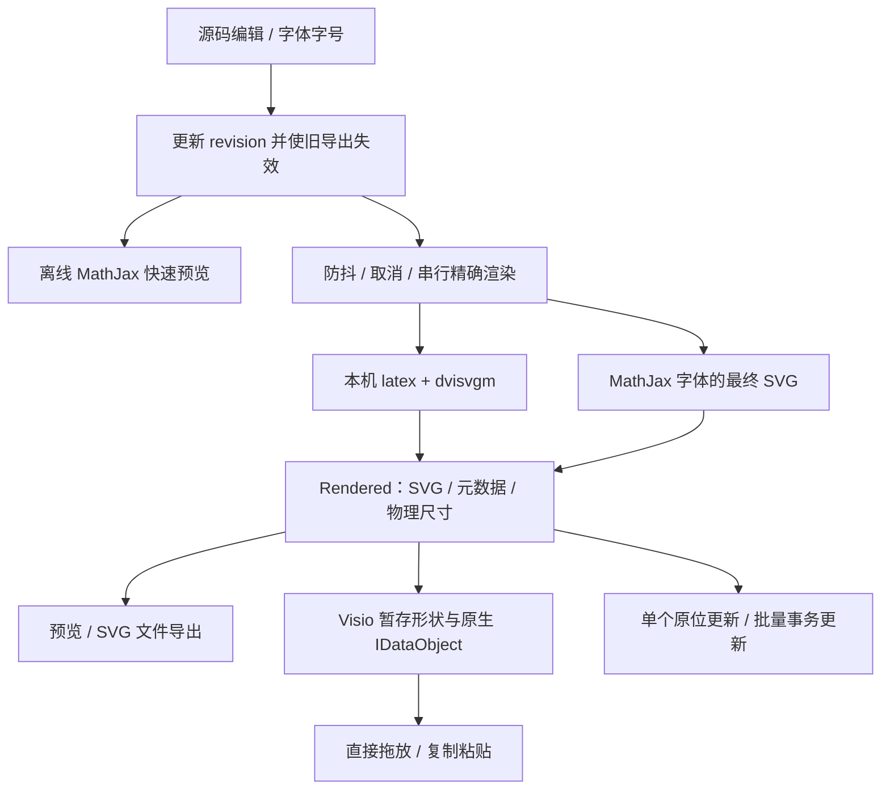

# Visio Formula：项目交接与实现说明

本文面向接手二次开发的 AI 和开发者，依据仓库中的实际实现整理。功能基线为 **0.9.0**，更新日期为 **2026-11-15（Asia/Shanghai）**。本版新增环境检查、设置中的可选自动原位更新和 20 MB 缓存管理。

先读本文，再读 [验证记录](VALIDATION.md) 和 [开发约定](../AGENTS.md)。仓库根目录的 `src/` 是唯一开发入口；本机 `work/` 和 `outputs/` 只是未纳入 Git 的工作资料与发布快照。不要在多个副本间交叉修改。

## 1. 产品目标与已经确定的交互

这个项目解决在 Visio 科研绘图中插入、保存和再次编辑 LaTeX 公式的问题。它是与 Visio 并排使用的独立 Windows 小工具，使用本机 TeX 和离线 MathJax，不需要安装 Visio 加载项。

用户已经明确的要求：

- 编辑区域在上、预览在下，窗口紧凑，主窗口、菜单、设置和批量操作窗口保持同一视觉风格。
- 以分式、矩阵、多行对齐等数学内容为主，兼顾英文说明、粗体和颜色。
- 输入期间快速预览，停顿后自动生成精确 SVG；不要求用户每次点击编译。
- 预览可以直接拖到 Visio；也可复制粘贴或单独导出 SVG。
- 源码随 Visio 文档保存。另一台电脑安装工具和必要依赖后，可以读回文档中的公式。
- 选中 Visio 公式，再在工具中点“编辑选中公式”；修改后点“原位更新”。
- 原位更新保留公式中心、旋转和已有等比缩放；内容变长时宽高自然改变。显式修改字号时应用新字号。
- 字体、字号、预览缩放和快捷输入设置下次打开继续使用；恢复上次草稿。
- 快捷输入参考用户的 Obsidian Quick LaTeX 使用习惯，支持自定义规则；同时保留可靠的撤销/重做和语法高亮。
- 可统一选中范围或整页中已有公式的字体、字号。

当前已实现上述主要流程。尚未实现完整的 TeX 编辑器、源码错误精确定位、独立安装器、软件自动升级和持续集成；详见第 13 节。

## 2. 技术栈与代码地图

运行平台是 Windows x64、.NET Framework 4.8。UI 使用 WinForms；预览嵌入 `WebBrowser`，其内核是 Windows MSHTML。源码使用 Windows 自带的 C# 5 编译器，当前没有 `.csproj`、SDK 风格项目或 NuGet 依赖。

仓库有 18 个应用源文件和 10 个测试/基准源文件。

| 文件 | 主要职责 |
| --- | --- |
| [src/App.cs](../src/App.cs) | Program、MainForm、控件与事件、快捷键、草稿、预览 JS 调用、批量操作调度 |
| [src/Core.cs](../src/Core.cs) | Formula、Rendered、Renderer、Bridge 的基础实现、Visio 原生拖放 COM 类型 |
| [src/RealtimeController.cs](../src/RealtimeController.cs) | 精确渲染防抖、取消、修订号、串行执行、16 项会话缓存 |
| [src/PreviewHtml.cs](../src/PreviewHtml.cs) | 离线页面拼装、SVG 显示与尺寸相关辅助逻辑 |
| [assets/preview.html](../assets/preview.html) | MathJax、快速/精确 SVG 展示、缩放、导出和 JS 状态接口 |
| [src/PreviewDragFilter.cs](../src/PreviewDragFilter.cs) | 拦截浏览器原生图片拖放，触发 Visio 原生对象拖放 |
| [src/FontCatalog.cs](../src/FontCatalog.cs) | 稳定字体 ID、显示名称、TeX 宏包 |
| [src/BatchStyle.cs](../src/BatchStyle.cs) | Bridge 扩展、范围遍历、目标快照、批量校验与事务 |
| [src/FormulaEditor.cs](../src/FormulaEditor.cs) | RichTextBox、语法高亮、自管撤销、IME、粘贴与键盘处理 |
| [src/QuickInput.cs](../src/QuickInput.cs) | 纯文本变换、缩写规则、占位位置、分式/上下标等转换 |
| [src/Settings.cs](../src/Settings.cs) | 字体、字号、缩放、自动更新、TeX 路径与缓存策略的加载和保存 |
| [src/WorkspaceState.cs](../src/WorkspaceState.cs) | 快捷输入配置、当前/历史草稿、带备份的 JSON 文件存储 |
| [src/EditorDialogs.cs](../src/EditorDialogs.cs) | 快捷输入设置、最近草稿、批量统一样式窗口 |
| [src/Theme.cs](../src/Theme.cs) | 公共颜色、圆角面板、按钮、菜单、复选框、字体选择器和草稿列表 |
| [src/AppMaintenance.cs](../src/AppMaintenance.cs) | 设置入口、首次环境检查、空闲清理、自动更新调度及预览缓存持有 |
| [src/CacheStore.cs](../src/CacheStore.cs) | 缓存标记、跨进程文件租约、容量/过期策略和保守删除边界 |
| [src/EnvironmentCheck.cs](../src/EnvironmentCheck.cs) | 工具发现、版本探测、子进程超时取消、环境诊断 |
| [src/UpdateBinding.cs](../src/UpdateBinding.cs) | 已读回目标的状态快照、外部修改/撤销识别和暂停状态 |
| [src/MaintenanceDialogs.cs](../src/MaintenanceDialogs.cs) | 通用设置、环境检查、缓存管理窗口 |

测试源码为 `EditorTests.cs`、`ThemeTests.cs`、`RealtimeTests.cs`、`BatchTests.cs`、`ConnectionTests.cs`、`IntegrationTests.cs`、`FontTests.cs`、`LatencyBenchmark.cs`，另有 `MaintenanceTests.cs` 和实际鼠标验证用的 `InteractiveTests.cs`。



## 3. 构建、启动和依赖

在仓库根目录的 PowerShell 中运行：

```powershell
.\build.ps1
.\VisioFormula.exe
```

构建脚本使用 `%WINDIR%\Microsoft.NET\Framework64\v4.0.30319\csc.exe`，指定 `winexe`、`x64`、优化、图标和 manifest；引用 Windows Forms、Drawing、Web.Extensions、Microsoft.CSharp。没有 Node.js 构建步骤。

输出到新目录：

```powershell
.\build.ps1 -OutputDirectory .\dist\VisioFormula
```

该模式同时复制完整 `assets` 与 `VisioFormula.exe.config`。分发至少需要 EXE、该 config 和完整 assets；只复制 EXE 不够。不要直接覆盖仍在运行的程序；让应用正常关闭以保存草稿后再替换。

本机 TeX 查找集中在 `Toolchain`：设置中的 `TexDirectory` → 未指定时读程序旁 `tex-bin.txt` → PATH → 固定磁盘根目录 `texlive/<版本>/bin/windows` → Program Files / LocalAppData 下常见 MiKTeX 目录。指定路径无效时明确报错，不静默使用另一套 TeX；选择新目录后清空会话渲染缓存。兼容旧 tex-bin.txt。

环境窗口先快速检查 Visio COM、工具版本、离线资源和设置/缓存可写性，点击“测试渲染”才逐个实际编译六种 TeX 字体及内嵌 MathJax。MathJax 测试仍走共享 SVG 输出。完整测试会暂停主窗口的渲染/自动同步，关闭后恢复；路径选择在关闭检查窗口后保存。

首次生产启动后台执行轻量检查；隔离测试设置路径不触发用户目录中的自动检查/清理。版本探测超时 5 秒；编译工具超时 30 秒，支持取消并异步排空 stdout/stderr。MiKTeX 编译附加 `--disable-installer`，避免诊断隐式安装宏包，依据 [MiKTeX 官方说明](https://docs.miktex.org/manual/texfeatures.html)。未在本机实际安装 MiKTeX 做端到端验证；已验证 TeX Live 和缺失工具路径。

当前实测环境为 TeX Live 2024 和 Visio Professional 2021 x64。MathJax 字体的精确 SVG 路径不依赖本机 TeX；普通六种 TeX 字体仍需要 TeX。窗口设置、草稿与运行缓存分开存储，见第 10 节。

## 4. 双阶段预览与精确渲染

### 4.1 时序、取消和缓存

`MainForm` 负责 UI 定时器与按钮状态，`RealtimeController` 负责精确渲染生命周期。

- 快速预览使用约 80 ms 的节流定时器，持续打字时也会刷新。
- 本机 TeX 精确渲染默认等待输入停顿 250 ms；MathJax 字体为 140 ms。
- Ctrl+Enter 将延时设为 0，并绕过缓存强制重编。
- 每个新请求取消前一个请求，递增 `Revision` 并清空当前可导出结果。
- `SemaphoreSlim` 使精确渲染串行执行；旧工作可以结束，但不能发布到新的 revision。
- 成功结果保存在 16 项 LRU 会话缓存中，键包含元数据版本、字体 ID、InvariantCulture 字号和原始源码；SVG 文件丢失时重新编译。
- 缓存命中也先让出一个异步调度周期，使浏览器 revision 更新，再发布结果。
- `MainForm.ready` 在输入变化时立即清空，复制、导出和更新按钮随之失效。不要把仍显示在面板中的旧 SVG 当成可输出的新结果。
- 失败只属于当前 revision；空输入清空显示；关闭窗口取消任务并使旧回调失效。

“250 ms”只是防抖等待，最终延迟还包含 TeX 进程启动、宏包加载、SVG 转换和 UI 消息处理。降低防抖会更频繁地启动、取消编译；继续优化时应先测量各阶段，不要只把等待改为 0。

### 4.2 本机 LaTeX 路径

`Renderer.Validate` 限制非空源码、最长 50000 字符及 4–96 pt 字号。`Body` 去掉常见外层数学定界符，将 `align`/`align*` 包装转换为 `aligned`，移除 equation 外壳；并非完整 LaTeX 文档解析器。

每次编译在 `%LOCALAPPDATA%\VisioFormula\Cache` 下创建 GUID 子目录，生成 `formula.tex`。模板使用 `standalone`、零边框、amsmath、字体宏包、bm 和 xcolor；按指定字号设置字体与行高，以 displaystyle 排版。主要命令：

```text
latex -interaction=nonstopmode -halt-on-error -no-shell-escape formula.tex
dvisvgm --no-fonts=1 --exact-bbox --bbox=min --output=formula.svg formula.dvi
```

stdout/stderr 异步读取，避免管道填满造成假死；每个工具超时 30 秒，取消会终止子进程。日志写入对应缓存目录。`Rendered` 现在实现 IDisposable，输出持有缓存租约；目前不调用 dvipng；`Rendered.Png` 是保留字段，不代表现行渲染链路。

SVG 使用路径字形，接收电脑不必安装对应数学字体。读取 SVG 根元素的 pt 尺寸并除以 72 得到 Visio 使用的英寸；随后嵌入公式元数据。后续改单位换算时必须回归已有文档的尺寸与缩放兼容性。

### 4.3 MathJax 与浏览器路径

离线资源为 MathJax 3.2.2 和 core-js-bundle 3.39.0。附带的 MathJax 已使用 Babel standalone 7.26.4 转成兼容 IE11/MSHTML 的 ES5；Babel 编译器本身不随程序运行。转换参数与许可见 [THIRD-PARTY.txt](../assets/THIRD-PARTY.txt)。

`PreviewHtml.CreateShell` 把模板与 JS 直接嵌入页面，无 CDN 请求。JS 使用 `base`、`ams`、`boldsymbol`、`newcommand`、`configmacros`、`color` 等包，`bm` 映射到 `boldsymbol`；SVG `fontCache: none`，避免输出依赖外部字形定义。

常用 JS 接口：`vfSetRevision`、`vfClear`、`vfQuick`、`vfExact`、`vfExactError`、`vfExport`、`vfGetState`、`vfViewport`、`vfZoom`、`vfPreviewSvg`。C# 通过 `Document.InvokeScript` 调用，浏览器访问必须在 UI STA 线程进行。

选择 `mathjax` 字体时，最终结果来自 `vfExport` 返回的 SVG。C# 轮询其 pending/svg/error 状态，约 25 ms 一次、最长 15 秒；按 1000 units/em 与字号换算物理尺寸，再走共享 SVG 存储逻辑。`vfSerialize` 处理 MSHTML 重复 namespace 属性问题，不要无回归测试地移除。

对其他字体，快速阶段仍是 MathJax 近似字形，最终阶段才是所选本机 TeX 字体。因此两阶段可能有字形、间距或布局差异。

### 4.4 显示缩放与 DPI

默认预览缩放为 150%，可选固定倍率或完整适配。固定倍率受可用宽高约束，短公式不会无条件放大撑满面板；完整适配模式允许按面板尺寸放大。预览缩放只影响显示，不能改变导出字号、SVG 文件或 revision。

`vfFit`、`vfViewport` 和 C# 的 viewport/DPI 换算共同决定缩放；CSS 像素与物理像素不能混用。应用 config 使用 PerMonitorV2。布局在初始化时先 SuspendLayout、设置 96 DPI 基准再恢复，避免控件重复缩放。

## 5. 字体与公式数据

字体 ID 已写入用户 Visio 文档，属于兼容性接口，不能随显示名称更改。

| ID | 显示系列 | 主要宏包 |
| --- | --- | --- |
| `latex` | Latin Modern | amssymb、lmodern |
| `times` | Times / NewTX | newtxtext、newtxmath |
| `stix2` | STIX Two | stix2 |
| `palatino` | Palatino / NewPX | newpxtext、newpxmath |
| `libertinus` | Libertinus | libertinus-type1、libertinust1math |
| `sans` | Sans / NewTXsf | helvet、sfdefault 设置、newtxsf |
| `mathjax` | MathJax / TeX | 离线 MathJax，不调用 TeX |

Times 风格适合与 Times 正文搭配，但并不等于直接使用 Windows 的 Times New Roman 字体文件。公式与文字协调应先统一字体家族和视觉字号，不应默认把所有公式加粗。

`Formula` 的持久字段：

```json
{
  "Version": 1,
  "Source": "x+1",
  "Font": "latex",
  "Size": 12,
  "BaseWidth": 0.3,
  "BaseHeight": 0.16
}
```

上例尺寸仅用于说明字段，实际值由 SVG 测得。`BaseWidth`/`BaseHeight` 单位是英寸，记录该内容在原始字号下的自然尺寸，用于区分内容变化与用户在 Visio 中的手动缩放。

`Rendered` 保存 Formula 克隆、缓存目录、SVG 路径和自然宽高；不要把屏幕预览尺寸写入这些字段。

## 6. Visio 关联、拖放、复制和源码保存

### 6.1 连接与多实例

没有安装型插件，也没有修改 Visio 注册配置。应用通过晚绑定 COM 自动化连接当前运行的 Visio。

生产代码使用 `new Bridge(false)`，需要运行中的 Visio；`RefreshActive` 通过 `Marshal.GetActiveObject("Visio.Application")` 刷新。读取选择、暂存拖放对象、收集批量范围和读取范围名称时均需考虑当前实例变化。

测试可使用 `Bridge(object application)` 明确绑定自己创建的实例，关闭自动跟随。这避免在用户实例上运行测试或泄漏额外 Visio 进程。

0.8.2 修复的重点是：缓存的 Application 可能仍指向旧窗口；读取当前选择必须刷新连接，而修改此前读回的公式应使用该目标的 `Application`。不能因为用户之后激活了另一个 Visio，就把撤销事务记到错误的文档实例。

### 6.2 原生拖放而非浏览器图片拖放

`Bridge.Stage` 创建工具拥有的暂存文档，导入精确 SVG、设置物理尺寸，通过临时透明边界形状建立外层公式组，再移除边界，写入元数据；外组命名为 `VF_Formula`，锁定等比缩放并设置选择行为。

取得形状的原生 COM `IDataObject` 后，由 `NativeDrag` 调用 OLE DoDragDrop。此拖放路径不需要先把 SVG 存到用户选定目录，也不依赖系统剪贴板。

`PreviewDragFilter` 捕获预览/拖动区域的鼠标按下、移动、抬起，在超过拖动阈值后释放 capture，并通过 BeginInvoke 启动拖放。它阻止 MSHTML 自己拖出预览图片。曾经“第一次正常、第二次变成大图片”的问题就与这条边界有关，不能把它简化为浏览器默认拖动。缩放下拉框不能被该过滤器拦截。

暂存文档跟随 Visio 实例；更换实例或退出时只关闭工具自己创建的暂存文档。`CloseStage` 会尝试刷新 OLE 剪贴板；断开的 COM 对象需防护。现有 `(object)stage != null` 判断有意避免 dynamic 在断开对象上触发绑定错误。

### 6.3 复制与导出

“复制到 Visio”调用原生 shape.Copy，遇到剪贴板被占用的 HRESULT `0x800401D0` 时最多尝试 8 次、间隔 80 ms。复制使用系统剪贴板；拖放和复制不能混为同一实现。

单独导出 SVG 会携带 JSON metadata，但只把普通 SVG 文件导入 Visio不等同于工具的完整原生公式组流程。可靠的读回/更新应使用工具原生拖放或复制创建的形状。

### 6.4 文档内元数据协议

SVG 中写入 id 为 `VisioFormula` 的 metadata。Visio 外层公式组在 User 单元格中保存：

- `User.VFVersion`：版本标识。
- `User.VFCount`：数据分块数量。
- `User.VFData0`、`User.VFData1`……：Formula JSON 经 UTF-8、Base64 编码后的字符串，每块 1000 字符。

读取时验证块数范围、Base64/JSON、Version=1 和有效的自然尺寸。检测公式主要依赖 VFCount 单元格存在；如果协议升级，必须提供迁移和旧文档回归测试。

用户保存 `.vsdx` 后源码随文档保存，不依赖本机渲染缓存。换电脑仍需安装本工具、Visio，以及该字体所需的 TeX 环境。截图、位图、手动取消组合或剥离 User 单元格会破坏这种关联。

## 7. 选中公式与原位更新

读回要求恰好选中一个完整公式组；目前不会自动向父组追溯子图形。错误信息包含连接的文档或选择数量，便于识别多窗口问题。

`ReadSelected` 刷新连接并读取元数据，验证字体与源码，归档当前草稿，保存目标 COM 引用和读回字号，再加载编辑器。目标引用在本次编辑期间保持，即使用户随后激活另一 Visio 实例。

`Bridge.Update` 在目标自己的 Application 上开启 undo scope。以当前形状宽高除以 BaseWidth/BaseHeight 得到缩放；一般编辑保留等比缩放。若两个轴缩放差异超过约 1.5%，拒绝含糊的非等比更新。用户明确改变字号时使用新字号的自然尺寸。

更新在已有外层组内导入新 SVG、删除旧内容，重新设置子图形的居中公式，恢复外组 PinX/PinY 和 Angle，并写入新的自然尺寸及元数据。因此外层图形 ID、中心位置和旋转得以保留，宽高随内容改变；失败回滚。

测试这条链路时，应同时检查视觉尺寸、Shape ID、中心、角度、元数据、保存重开以及单次撤销。只检查画面出现新公式是不够的。

### 7.1 可选自动原位更新（0.9）

开关位于“更多 → 设置”，主窗口没有开关；`Preferences.AutoUpdate` 默认 false 并持久化。恢复偏好不恢复 COM 目标。必须显式读回一个完整公式组才能建立 `UpdateBinding`。

`UpdateBinding` 保存形状引用、文档/页/形状标签、完整 Formula JSON 和几何快照。100 ms 的 UI 定时器在停止输入至少 600 ms、`ready` 为当前 RealtimeController 结果且内容一致时尝试写回；重复内容跳过。慢编译完成后可立即同步，不额外再等 600 ms。

每次提交前校验目标；空闲时约 500 ms 检查一次。源码/元数据或几何变化（含 Visio Undo）导致暂停，删除/关闭导致解除绑定；已暂停目标也继续检查是否消失。暂停不会因再次输入自动解除，重新读回或明确手动更新后恢复。读取新选区失败也暂停旧关联，避免修改错误目标。

自动写入复用 `Bridge.Update` 和目标 Application 的 undo scope。每次实际同步是一条 Visio 撤销记录，不长期开启跨输入事务。编辑器自身 Ctrl+Z 仍独立管理源码。改变 Visio 选区不会转移绑定；编译过程中显式读回新目标则递增渲染 revision，使旧结果失效。

新建、恢复草稿、批量修改命中目标时清除绑定。设置/环境/缓存窗口通过 maintenanceDepth 暂停同步；批量操作通过 busy 暂停。窗口上的状态和提示显示目标及暂停原因，不自动保存用户的 Visio 文档。

## 8. 批量统一样式

入口可针对当前选择或整页。`Collect` 递归遍历组内形状，遇到完整公式组就记录并停止向其内部遍历，用 ID 去重，跳过普通图形。

每个 `FormulaTarget` 保存原始 Formula、JSON 指纹、Shape ID、宽高、中心和角度。范围键包含 Visio `Application.ProcessID`、Document.ID、Page.ID；这里的 Visio ProcessID 不应当作 Windows 进程 PID 使用。

批量操作分为两个阶段：

1. 锁定 UI 操作，暂停普通实时渲染，按目标克隆并修改样式；串行生成全部精确结果，同样内容复用本次批量缓存。此阶段可取消，尚不修改 Visio。
2. 再次检查范围、目标所属实例、源码指纹、几何变化、SVG 文件及 XML 根元素。全部通过后，在目标 Application 的一个外层 undo scope 内执行更新；任何失败整体回滚。

几何变化容差约为 `1e-7 * max(1, abs(value))`。混合不同 Visio 实例的目标不能放进一个事务。提交阶段是同步写回，不提供在中途任意打断的“半完成取消”；失败由事务回滚。

仅改变字体时保留原来的等比放大；明确统一字号时采用指定字号。如果本来载入的单个编辑目标包含在批量范围内，批量完成后解除旧编辑绑定，避免后续误更新。

## 9. 源码编辑器与 Quick LaTeX 风格输入

### 9.1 编辑状态与撤销

`FormulaEditor` 使用 RichTextBox，但把它当纯文本编辑器。撤销/重做由 `EditState` 快照维护，包含文本、选区和 Tab 占位位置，最多保存 300 个撤销状态。加载另一份文档时清空撤销栈；产生新分支时清空 redo。

原生 RichTextBox 撤销栈被清理，避免颜色格式修改污染用户撤销。高亮约 90 ms 后执行，识别命令、括号、上下标/对齐字符、数字和注释，保存并恢复选区与滚动位置，短暂抑制重绘；不能触发源码变更通知。

IME 组合输入期间禁止快捷展开，并把组合提交作为一次撤销操作。粘贴只接受纯文本并规范换行；禁用 Ctrl+B/I/U 等富文本格式。大文档采用全量快照，尚不是增量编辑模型。

### 9.2 规则和占位符

`QuickInput` 主要是 EditState 到 EditState 的纯文本变换，不依赖 Obsidian。默认规则共 44 条；这是一套迁移使用习惯的实现，不是嵌入整个 Obsidian 插件，也不承诺兼容其全部未来版本。

规则格式：

```text
al:::\alpha;
sq:::\sqrt{#cursor}#tab;
```

以分号和换行划分规则；触发词最长 40 字符、不能含空白、不允许重复。配置最长 100000 字符，每条至多一个 `#cursor`；`#tab` 和 `#tabN` 定义后续跳转位置。插入时删除标记并记录索引，不能把这些标记留到 TeX 源码里。

默认空格展开，可配置 Tab 展开；Tab / Shift+Tab 在占位位置间移动。Shift+Space 只展开缩写、不执行部分附加转换。分式、上下标、括号、极限等行为有独立开关；文字环境和注释有抑制规则。

Alt+Shift+M/A/C 分别插入矩阵、对齐和 cases 环境；相关环境内提供 Tab/Enter 行列输入处理。新增转换应优先写入纯文本状态机，并测试光标、选区、占位符位置和一次撤销语义。

设置支持自有配置 JSON、规则文本，以及 Obsidian Quick LaTeX JSON 中的 `customShorthand_parameter`、`useTabtoComplete_toggle`、`addMatrixBlock_parameter` 等已识别字段。导入后点击保存才生效。设置窗口的 Windows CRLF 规范化很重要，否则多行规则可能显示为一行。

## 10. 设置、草稿与缓存

默认个人数据目录为 `%LOCALAPPDATA%\VisioFormula`：

| 文件 | 内容与写入方式 |
| --- | --- |
| `settings.json` | Version、Font、Size、Zoom、AutoUpdate、AutoClean、CacheLimitMB、CacheDays、TexDirectory、EnvironmentChecked；原子替换 |
| `settings.quick-input.json` | 快捷开关和规则；保存按钮提交；带 `.bak` 备份 |
| `settings.drafts.json` | Version=1、Current、History；原子替换并保留 `.bak` |

`WorkspaceState` 根据传入的偏好文件名推导两个关联文件名。测试必须传独立 `SettingsStore` 路径，不能使用真实用户配置进行试验。JSON 主文件反序列化异常时尝试 `.bak`；这不等同于完整的语义损坏修复。

默认偏好是 Latin Modern、12 pt、150% 预览。当前草稿保存源码、字体、字号、选区位置和 UTC 时间戳；恢复草稿后使用草稿里的样式。编辑或光标变化停顿约 450 ms 保存；样式偏好有约 350 ms 的保存定时器，窗口关闭时再保存一次。

“当前草稿”是持续覆盖的恢复点；“最近草稿”是切换文档时的归档列表，二者不同：

- 新建、成功读回 Visio 公式、恢复另一历史草稿之前，归档当前非空且有效的内容。
- 以源码、字体、字号去重，新记录放最前，最多保留 20 条。
- 恢复历史不会自动删除该历史项，也不是每次输入都增加一条历史。
- 新建保留当前字体字号、清空内容并断开目标；恢复草稿也断开 Visio 目标。
- 启动恢复不恢复进程内 COM 对象，也不恢复上一进程的撤销栈。

### 10.1 缓存策略与生命周期（0.9）

默认目录为 `%LOCALAPPDATA%\VisioFormula\Cache`；测试通过进程环境变量 `VISIOFORMULA_CACHE` 使用隔离目录。默认 AutoClean=true、CacheLimitMB=20、CacheDays=7。启动后空闲及每分钟尝试清理：先按最后使用时间移除过期/最旧的可释放项，向 20 MB 目标收敛。正在持有的内容可暂时超额。手动清理移除全部可释放项。

每个 GUID 目录包含 `.vf-cache` 标记和 `.lease` 文件。创建/扫描/删除用按根路径散列的命名互斥锁串行化；编译期间及 Rendered 存活期间持有不能独占打开的文件租约。清理只有独占取得租约后才可删除，因此其他进程/窗口也受保护。当前预览通过 `Rendered.Pin()`、16 项 LRU 通过 Rendered 所有权、Visio 暂存对象通过 stagePin 保持引用；批量结果在提交/取消 finally 释放。

`Renderer.Render` / `RenderMathJax` 返回的结果由调用者负责 Dispose；将结果交给 RealtimeController 后由其管理缓存所有权。额外使用期间调用 Pin 并在结束后释放。旧请求取消后迟到的结果也必须 Dispose。不要依赖 GC 作为日常清理机制。

删除前校验绝对路径、父目录、GUID 名称、标记、文件白名单；拒绝目录链接/reparse point、子目录和未知文件，不递归删除任意目录。生成新类型的中间文件时需要同步白名单和测试。遇到文件被占用/无权限则跳过。

当前程序旁旧 `cache/` 默认仅识别，手动勾选后清理已确认的 GUID 编译目录；同目录其他旧版进程运行时保留。不会扫描或删除其他安装副本中的目录。草稿、设置、导出的 SVG 与 Visio 文档不属于清理范围。

迁移电脑时复制整个程序文件夹；个人偏好、快捷输入和草稿需另外复制上述 LocalAppData 目录。图中源码由 `.vsdx` 自身携带。

## 11. 界面修改注意事项

主窗口逻辑 client size 约 432×590，最小约 344×460。保持输入在上、预览在下；更多菜单承载设置、环境检查、缓存管理、快捷输入、最近草稿和批量操作。

公共控件位于 Theme，新增子菜单或对话框应复用这些控件，避免重新出现系统默认的旧式边框与按钮。字体、字号和 pt 单位需检查同一水平中心，而不只比较控件 Top 值。

字体选择器对关闭状态的显示进行自绘，保留原生 ComboBox 的键盘和下拉行为。处理 WM_PRINT 绘制时必须只填充控件自身区域；曾使用 Graphics.Clear 导致其他控件区域被擦除，不能重新引入。

源码不显示无实际价值的“编辑中”提示。精确渲染自动触发，主界面无需常驻“立即精确渲染”按钮，保留 Ctrl+Enter 即可。

## 12. 回归测试与发布检查

具体命令、最新运行结果和历史证据见 [VALIDATION.md](VALIDATION.md)。改动与测试的对应关系：

| 改动 | 优先验证 |
| --- | --- |
| 快捷输入、撤销、草稿 | test-editor.ps1 |
| 菜单、设置、布局和 DPI | test-theme.ps1；实际窗口检查 |
| 防抖、缓存、预览、字号与缩放 | test-realtime.ps1 |
| TeX 字体/模板 | test-fonts.ps1；必要时 test-latency.ps1 |
| 单个导入、复制、保存重开、更新 | run-tests.ps1 |
| 批量范围与事务 | test-batch.ps1 |
| 环境、缓存、自动更新、新窗口 DPI | test-maintenance.ps1；无 Visio 可用 -WithoutVisio，并标记未测集成部分 |
| 实际鼠标拖放 | build-interactive-tests.ps1 构建后运行 InteractiveTests.exe；关闭测试工具会保存并关闭其自建绘图 |
| 多 Visio 实例连接与目标归属 | test-connection.ps1；按 ACTIVATE 提示真实切换前台窗口 |

Visio 测试只能操作自己创建且明确拥有的实例/文档。创建实例后应直接传给 Bridge；不要先创建一个 Bridge(true) 再覆盖 Application，旧写法可能留下孤立进程。通过 finally 清理自己创建的资源，不操作用户正式绘图。

跨实例测试不能仅靠 COM Window.Activate 推断真正的用户焦点切换。原生 IDataObject API 传输覆盖不等于鼠标连续拖放覆盖；测试报告应明确区分。

新版本建议流程：修改根目录源码 → 更新相关测试与文档 → 运行对应检查 → 输出到新 dist 目录 → 用干净目录启动/拖放/读回检查 → 生成发布文件夹和 ZIP。不要把测试缓存、真实草稿、个人路径或临时 Visio 文档提交到 Git。

## 13. 已知边界与后续优先事项

以下内容是未完成事项或已知维护风险，不应被接手者误认为现有功能：

1. **错误定位**：当前以编译错误提示/日志为主，没有把 TeX 行列位置可靠映射回源码编辑区。
2. **浏览器内核**：MSHTML 要求附带 JS 保持 ES5 兼容。迁移 WebView2 会改变安装依赖、包体积、调用时序和拖放，需要单独设计。
3. **精确渲染延迟**：已经有缓存清理与会话 LRU，尚无后台 TeX 常驻服务；每次未缓存编译仍有进程启动成本。
4. **编辑性能**：长文本的全量高亮和 300 份撤销快照可能消耗较多内存；目前没有语法树或增量文档模型。
5. **内容范围**：面向数学片段与英文说明；完整文档、TikZ、中文排版及任意自定义宏包工作流未作为现行保证。MathJax 也不能覆盖所有 TeX 命令。
6. **草稿管理**：最近 20 条归档不是连续版本历史，尚无收藏、命名、搜索或可视化逐项删除管理。
7. **对象选择**：尚不自动把被选中的内部 SVG 子形状提升为公式外层组。取消组合可能破坏可编辑元数据。
8. **数据校验**：现有持久数据有基本版本和范围校验，进一步强化 NaN/Infinity、超大或语义损坏数据需要补充测试。
9. **版本元信息**：UI、程序集与 manifest 已更新到 0.9.0；后续发布仍须同步这些入口和文档版本。
10. **打包与授权**：没有安装器、自动更新或 CI 发布流程；项目自有代码的开源许可证尚未指定，第三方许可证已经保留。
11. **输入边界**：TeX 使用 `-no-shell-escape`，但这不是操作系统文件访问沙箱；当前产品针对本机用户自己输入的公式。

优先级建议：处理可定位的编译错误，再改善选中子图形的读回体验、草稿管理和版本/发布自动化。修改持久协议、Visio 连接或撤销事务之前，先建立旧文档回归样本。

## 14. 给下一位 AI 的开始步骤

1. 读取本文、AGENTS 和验证记录，执行 `git status`，确认用户当前未提交的修改。
2. 只从根目录 `src`、`assets` 和构建脚本开始；不要使用本机历史副本覆盖它们。
3. 读对应模块及已有测试，复现用户问题，区分渲染、显示、元数据和 Visio 实例问题。
4. 保持上文的持久字段、单位换算、取消/revision、原生拖放与事务归属约束。
5. 用独立设置文件和自建 Visio 测试文档验证；对未实际运行的项目明确标记未测。
6. 提交前检查 `git diff --check`、文件列表、第三方许可和个人数据排除情况，再同步更新说明。
